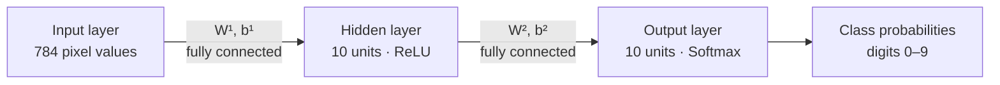

# MNIST Digit Classifier: Neural Network Notes

This document turns the whiteboard notes into a compact description of a
fully connected neural network for classifying handwritten MNIST digits.

## 1. Image and dataset representation

Each MNIST image is a grayscale image of size **28 × 28** pixels. Flattening
the image gives **784 input features**. Pixel intensities range from 0
(black) to 255 (white); scale them to `[0, 1]` before training, for example
by dividing by 255.

For `m` examples, arrange the inputs as columns:

| Symbol | Shape | Meaning |
| --- | --- | --- |
| `X` | `784 × m` | One flattened image per column |
| `Y` | `10 × m` | One-hot target labels, one column per image |
| `y` | `m` labels | Integer digit labels from 0 through 9 |

The notes use `m = 20,000` as an example training-set size. The network
itself can be trained with any number of examples.

## 2. Network architecture

The model has one hidden layer with 10 units and an output layer with 10
units—one output for each digit class. The hidden layer uses ReLU, and the
output layer uses softmax to produce class probabilities.



Each arrow represents connections from every unit in one layer to every
unit in the next layer. The drawing shows layer sizes, not every individual
neuron or connection.

### Parameter dimensions

| Parameter | Shape | Purpose |
| --- | --- | --- |
| `W¹` | `10 × 784` | Input-to-hidden weights |
| `b¹` | `10 × 1` | Hidden-layer biases |
| `W²` | `10 × 10` | Hidden-to-output weights |
| `b²` | `10 × 1` | Output-layer biases |

Bias columns are broadcast across the `m` examples during batch computation.

## 3. Forward propagation

Let `A⁰ = X`. Compute the hidden layer and output layer as follows:

```text
Z¹ = W¹ A⁰ + b¹
A¹ = ReLU(Z¹) = max(0, Z¹)

Z² = W² A¹ + b²
A² = softmax(Z²)
```

For a single example, softmax converts the 10 output logits into
probabilities that sum to 1. The predicted digit is the index with the
largest probability:

```text
prediction = argmax(A²)
```

Use a numerically stable softmax. If logits are arranged as
`classes × examples`, normalize each example's column:

```python
shifted = Z - np.max(Z, axis=0, keepdims=True)
exp_Z = np.exp(shifted)
probabilities = exp_Z / np.sum(exp_Z, axis=0, keepdims=True)
```

Subtracting the largest logit does not change the resulting probabilities,
but prevents exponential overflow.

## 4. Labels and loss

The integer label `3`, for example, is represented as a one-hot target with
the entry for class 3 set to 1 and all other entries set to 0. With
`classes × examples` layout, `Y` has shape `10 × m`.

The usual loss for this softmax classifier is average cross-entropy:

```text
L = -(1/m) Σᵢ Σₖ Yₖᵢ log(A²ₖᵢ)
```

Here, `i` indexes examples and `k` indexes digit classes.

## 5. Backpropagation

For softmax with cross-entropy, the output-layer error simplifies to:

```text
dZ² = A² - Y
dW² = (1/m) dZ² (A¹)ᵀ
db² = (1/m) Σcolumns dZ²
```

Propagate the error through the ReLU hidden layer:

```text
dZ¹ = (W²)ᵀ dZ² ⊙ ReLU'(Z¹)
dW¹ = (1/m) dZ¹ Xᵀ
db¹ = (1/m) Σcolumns dZ¹
```

`⊙` means element-wise multiplication. The ReLU derivative is 1 where
`Z¹ > 0` and 0 otherwise. The sums for `db¹` and `db²` are taken across
the example columns, keeping the bias-gradient shapes `10 × 1`.

## 6. Gradient descent training loop

Start with small random weights and biases, then repeat:

1. Run forward propagation to compute `A¹` and `A²`.
2. Compare `A²` with the one-hot labels `Y`.
3. Backpropagate to calculate gradients.
4. Update every parameter:

   ```text
   W¹ ← W¹ - α dW¹       b¹ ← b¹ - α db¹
   W² ← W² - α dW²       b² ← b² - α db²
   ```

Here `α` is the learning rate. The notes show `0.1` as an example; if the
loss or weights become unstable, try a smaller learning rate and verify
that inputs are scaled consistently.

## 7. Checking predictions and accuracy

For each example, compare the predicted class with the true integer label:

```text
predictions = argmax(A², axis=0)
accuracy = mean(predictions == labels)
```

For ten balanced classes, accuracy near 10% is approximately random
guessing. If training produces `NaN` values, inspect the logits and
gradients, use the stable softmax above, and check the learning rate and
input scaling.
